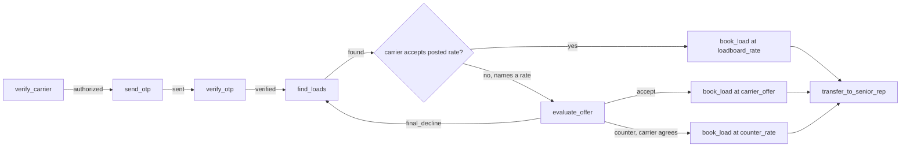

# Crystal Lane Freight · Carrier Sales Adapter API

**Integration guide for the HappyRobot inbound carrier-sales agent · API version 1.2.1**

This document is everything needed to connect a HappyRobot workflow to the Crystal Lane Freight
carrier-sales API: connection details, the response contract, every endpoint with all possible
outcomes, what the agent should do with each outcome, ready-to-use tool definitions, a complete
example call, and the full OpenAPI 3.1 specification (Appendix A).

---

## 1. What the API does

Crystal Lane Freight is a freight broker. Carriers call in to book loads. The HappyRobot voice agent
talks to the carrier; this API talks to Crystal Lane's systems (the legacy TMS, FMCSA and the SMS
provider) and **enforces every business and compliance rule itself**:

- Only carriers with **active FMCSA operating authority** can proceed.
- The carrier proves identity with a **one-time code (OTP) texted to the phone number on file**.
- Load search, negotiation, booking and handoff are **only possible after the OTP is verified**.
- The **negotiation ceiling is never revealed**; the API decides accept / counter / decline.
- A load can only be booked at the **posted rate or a rate the API approved** on this call.

The agent's prompt is a second line of defence. If the agent skips a step, invents a load ID or
quotes an unapproved rate, the API refuses.

---

## 2. Connection

| Item | Value |
|---|---|
| Base URL | `https://ca-clf-adapter.jollyglacier-d430eeb3.eastus.azurecontainerapps.io/v1` |
| Protocol | HTTPS only (plain HTTP redirects to HTTPS) |
| Method | `POST` with a JSON body for every agent tool (`GET` only for `/health`) |
| Content type | `Content-Type: application/json` |
| Authentication | Header `X-API-Key: <API_KEY>`. The key is provided separately; store it as a secret in HappyRobot, never in the prompt |
| Call grouping | Header `X-Call-Id: <run id>`: the HappyRobot run/call ID. **Send the same value on every request of one call** |
| Timeout | Answers in under 1 second normally; worst case about 4 seconds (internal TMS retries). Set the webhook timeout to **10 seconds** |

### Required headers on every tool call

```
X-API-Key: <API_KEY>
X-Call-Id: <HappyRobot run id, same for the whole call>
Content-Type: application/json
```

- `X-Call-Id`: 1 to 128 characters, letters, digits and `. _ : -` only (a UUID is ideal).
  The API keeps the call's progress (OTP attempts, negotiation rounds, approved rates) under this
  ID for 1 hour. A new ID means a new call that starts again from step 1.
- Rate limit: 60 requests per minute per `X-Call-Id`.

---

## 3. Response contract (read this first)

**Every reply is HTTP 200 and every endpoint always returns exactly the same keys**, whether it
succeeds or fails. The only exception is a missing or wrong API key: HTTP 401 (a setup problem,
not a call outcome).

Every reply starts with these four fields:

| Field | Type | Meaning |
|---|---|---|
| `ok` | boolean | `true`: the request was processed. `false`: the request itself failed |
| `error_code` | string or null | `null` when `ok` is true; otherwise what failed (see section 6) |
| `error_message` | string or null | `null` when `ok` is true; otherwise what went wrong, phrased so the agent can act on it |
| `retryable` | boolean | `true` when sending the same request again may succeed |

After them come the endpoint's own fields. **When `ok` is false, every endpoint field is `null`**
(lists are `[]`). `null` means "unknown", never "no".

### `ok` is not "good news"

`ok: true` means the request worked. The answer can still be a "no":

```json
{"ok": true, "error_code": null, "error_message": null, "retryable": false,
 "authorized": false, "carrier_name": null, "authority_status": "revoked", "reason": "authority_revoked"}
```

That carrier is not allowed to haul: a real answer, so the agent ends the call politely.

`ok: false` means the request failed and the answer is unknown:

```json
{"ok": false, "error_code": "fmcsa_unavailable", "error_message": "FMCSA did not respond; try again shortly", "retryable": true,
 "authorized": null, "carrier_name": null, "authority_status": null, "reason": null}
```

### How the agent reads any reply

1. If `ok` is `false`:
   - If `retryable` is `true`, retry the same request once. If it fails again, apologise and offer a callback.
   - If `error_code` is `invalid_request`, read `error_message`, fix the input (usually by asking the carrier again) and resend.
   - If `error_code` is `step_out_of_order`, a previous step is missing; `error_message` names it. Do that step first.
   - Never use the other fields of a failed reply.
2. If `ok` is `true`, act on the endpoint's `status`, `decision` or `authorized` field as described in section 5.

### Other conventions

- Money is **US dollars as a number**, whole dollars returned as integers (`2250`, not `2250.0`). Say it as "two thousand two hundred fifty dollars".
- Dates and times are ISO 8601 with the local time zone of the stop, e.g. `2026-10-08T08:00:00-05:00`.
- **Send only the documented body fields.** An unknown field is rejected with `invalid_request` ("phone is not an accepted field").
- **Empty optional fields are fine.** `""` (or `null`) in an optional field means "not given". An empty *required* field fails with `invalid_request`, "<field> is required".
- Fields that are never returned or logged: the max rate, OTP codes, full phone numbers, API keys, TMS credentials.

---

## 4. Call flow

The steps must happen in this order on one `X-Call-Id`. Calling a step too early returns
`ok: false` with `error_code: step_out_of_order`.

| # | Agent action | Endpoint | Unlocks |
|---|---|---|---|
| 1 | `verify_carrier` | `POST /carriers/verify` | step 2, if `authorized` is true |
| 2 | `send_otp` | `POST /otp/send` | step 3 |
| 3 | `verify_otp` | `POST /otp/verify` | steps 4 to 7, if `status` is `verified` |
| 4 | `find_loads` | `POST /loads/search` | step 5 or 6 for the loads it returned |
| 5 | `evaluate_offer` | `POST /offers/evaluate` | approved rates for step 6 (only needed when the carrier wants a different rate) |
| 6 | `book_load` | `POST /loads/{load_id}/book` | step 7, if `status` is `booked` |
| 7 | `transfer_to_senior_rep` | `POST /handoff` | end of call |



Repeating a step is allowed where it makes sense: search again with other criteria, evaluate
another offer, or call `book_load` again (it returns the same booking).

---

## 5. Endpoints

All paths are relative to the base URL. All examples show the complete reply.

### 5.1 `verify_carrier` · `POST /carriers/verify`

Checks the carrier's operating authority with FMCSA. Call it as soon as the carrier gives their MC number.

**Request body**

| Field | Type | Required | Rules |
|---|---|---|---|
| `mc_number` | string | yes | MC number, digits only, 1 to 8 digits. Spaces and dashes are removed (`"123 456"` works). Do not include the letters "MC": `"MC123456"` is rejected |

```json
{"mc_number": "123456"}
```

**Reply fields** (after the four envelope fields)

| Field | Type | Values |
|---|---|---|
| `authorized` | boolean or null | `true` only when authority is active |
| `carrier_name` | string or null | Legal name, only when authorized |
| `authority_status` | string or null | `active`, `inactive`, `revoked`, `not_found` |
| `reason` | string or null | `authority_inactive`, `authority_revoked`, `carrier_not_found`, or null when authorized |

**Outcomes and what the agent does**

| Reply | Agent |
|---|---|
| `ok: true`, `authorized: true` | Greet the carrier by `carrier_name`, explain a code will be texted to the number on file, call `send_otp` |
| `ok: true`, `authorized: false`, `reason: carrier_not_found` | Read the MC number back to confirm it. If it was misheard, call `verify_carrier` again with the corrected number; otherwise explain Crystal Lane can't find that MC and end politely |
| `ok: true`, `authorized: false`, `reason: authority_inactive` or `authority_revoked` | Explain Crystal Lane can only work with carriers with active operating authority, and end politely |
| `ok: false`, `invalid_request` | Ask for the MC number again (digits only) and resend |
| `ok: false`, `fmcsa_unavailable` (retryable) | Retry once, then apologise and offer a callback |
| `ok: false`, `step_out_of_order` | This call already passed the code check under another MC number; continue with that carrier |

```json
{"ok": true, "error_code": null, "error_message": null, "retryable": false,
 "authorized": true, "carrier_name": "Blue Ridge Transport LLC", "authority_status": "active", "reason": null}
```

```json
{"ok": false, "error_code": "invalid_request", "error_message": "mc_number is required", "retryable": false,
 "authorized": null, "carrier_name": null, "authority_status": null, "reason": null}
```

### 5.2 `send_otp` · `POST /otp/send`

Texts a 6-digit code to the phone number **on file** for the MC number. There is intentionally no
phone field: the agent can never choose where the code goes. The code expires after 5 minutes. A
call can send at most 2 codes (the first plus one resend), and a resend makes the previous code invalid.

**Request body**

| Field | Type | Required | Rules |
|---|---|---|---|
| `mc_number` | string | yes | Same MC number that was verified on this call |

```json
{"mc_number": "123456"}
```

**Reply fields**

| Field | Type | Values |
|---|---|---|
| `status` | string or null | `sent`, `resend_limit_reached`, `no_phone_on_file`, `not_authorized` |
| `masked_phone` | string or null | Last 4 digits only, e.g. `***-***-4821`, when sent |
| `expires_in_seconds` | integer or null | `300` when sent |
| `resends_remaining` | integer or null | `1` after the first send, `0` after the resend |

**Outcomes and what the agent does**

| Reply | Agent |
|---|---|
| `status: sent` | "I've just texted a 6-digit code to your phone ending in 4821. Please read it to me." Wait for the code, then call `verify_otp` |
| `status: resend_limit_reached` | No more codes on this call. Apologise and offer a callback |
| `status: no_phone_on_file` | Explain there's no phone on file to verify against and offer to have a rep follow up. End the call |
| `status: not_authorized` | The carrier failed the authority check; do not continue |
| `ok: false`, `step_out_of_order` | Call `verify_carrier` first (or, if the code was already verified, continue to `find_loads`) |
| `ok: false`, `sms_unavailable` (retryable) | Retry once, then apologise and offer a callback |

Only call `send_otp` again (a resend) if the carrier says they didn't receive the code or it expired.

```json
{"ok": true, "error_code": null, "error_message": null, "retryable": false,
 "status": "sent", "masked_phone": "***-***-4821", "expires_in_seconds": 300, "resends_remaining": 1}
```

### 5.3 `verify_otp` · `POST /otp/verify`

Checks the code the carrier reads back. A call gets 3 attempts in total, then it is locked.

**Request body**

| Field | Type | Required | Rules |
|---|---|---|---|
| `mc_number` | string | yes | Same MC number as above |
| `code` | string | yes | Exactly 6 digits. Spaces and dashes are removed (`"482 913"` works) |

```json
{"mc_number": "123456", "code": "482913"}
```

**Reply fields**

| Field | Type | Values |
|---|---|---|
| `status` | string or null | `verified`, `incorrect`, `expired`, `attempts_exhausted`, `not_sent` |
| `attempts_remaining` | integer or null | 0 to 3 |

**Outcomes and what the agent does**

| Reply | Agent |
|---|---|
| `status: verified` | Thank the carrier, ask where they are, where they want to go, their equipment and pickup date, then call `find_loads` |
| `status: incorrect` | Say the code didn't match and ask them to read it again (`attempts_remaining` left) |
| `status: expired` | The code expired. Offer a new one with `send_otp` if `resends_remaining` was 1. An expired code doesn't use an attempt |
| `status: attempts_exhausted` | Too many wrong codes; verification is locked for this call. Apologise and end the call |
| `status: not_sent` | No code was sent yet; call `send_otp` |
| `ok: false`, `invalid_request` | The code wasn't 6 digits (e.g. misheard). Ask again; this does not use an attempt |

```json
{"ok": true, "error_code": null, "error_message": null, "retryable": false, "status": "verified", "attempts_remaining": 2}
```

### 5.4 `find_loads` · `POST /loads/search`

Searches available loads in Crystal Lane's TMS. Returns at most 3, best match first. Only
available loads are returned. The search understands spoken places: "near Chicago", "DFW",
"Texas", "Saint Louis". A load nearby (within about 150 miles) or in the same state still matches.

**Request body**

| Field | Type | Required | Rules |
|---|---|---|---|
| `mc_number` | string | yes | Same MC number as above |
| `origin` | string | yes | Where the truck is or will be empty, e.g. `"Joliet, IL"`, `"near Chicago"`, `"Texas"` |
| `destination` | string | no | Where the carrier wants to go, e.g. `"Dallas, TX"`. Send `""` (or leave it out) when the carrier has no preference |
| `equipment_type` | string | yes | `dry_van`, `reefer` or `flatbed`. Spoken forms also work: "Dry Van", "van", "refrigerated", "flat bed" |
| `pickup_date` | string | no | `YYYY-MM-DD`. Loads within 2 days of it are considered. Send `""` (or leave it out) for any date |

```json
{"mc_number": "123456", "origin": "Joliet, IL", "destination": "Dallas, TX", "equipment_type": "dry_van", "pickup_date": "2026-10-08"}
```

**Reply fields**

| Field | Type | Values |
|---|---|---|
| `status` | string or null | `found`, `no_match` |
| `loads` | array | 0 to 3 Load objects, best first. `[]` on `no_match` or failure |

**Load object** (never contains the max rate)

| Field | Type | Example |
|---|---|---|
| `load_id` | string | `LD-10482` |
| `origin` | string | `Joliet, IL` |
| `destination` | string | `Dallas, TX` |
| `pickup_datetime` | date-time | `2026-10-08T08:00:00-05:00` |
| `delivery_datetime` | date-time | `2026-10-09T17:00:00-05:00` |
| `equipment_type` | string | `dry_van` |
| `loadboard_rate` | number | `2100`: the posted rate in US dollars |
| `weight` | integer | `42000` (pounds) |
| `commodity_type` | string | `Paper goods` |
| `num_of_pieces` | integer | `24` |
| `miles` | integer | `925` |
| `dimensions` | string | `48x40x60` |
| `notes` | string | `Driver assist not required` |

**Outcomes and what the agent does**

| Reply | Agent |
|---|---|
| `status: found` | Pitch the first load: lane, pickup and delivery times, equipment, weight, commodity, miles and the posted rate (`loadboard_rate`). Mention the others if the first doesn't fit |
| `status: no_match` | Say nothing matches right now; offer to search with a different origin, destination, date or equipment, or end politely |
| `ok: false`, `step_out_of_order` | The code isn't verified yet; finish `verify_otp` first |
| `ok: false`, `tms_unavailable` or `tms_malformed_response` (retryable) | Retry once, then apologise and offer a callback |

```json
{"ok": true, "error_code": null, "error_message": null, "retryable": false, "status": "found",
 "loads": [{"load_id": "LD-10482", "origin": "Joliet, IL", "destination": "Dallas, TX",
            "pickup_datetime": "2026-10-08T08:00:00-05:00", "delivery_datetime": "2026-10-09T17:00:00-05:00",
            "equipment_type": "dry_van", "loadboard_rate": 2100, "weight": 42000, "commodity_type": "Paper goods",
            "num_of_pieces": 24, "miles": 925, "dimensions": "48x40x60", "notes": "Driver assist not required"}]}
```

### 5.5 `evaluate_offer` · `POST /offers/evaluate`

Use it when the carrier asks for a rate different from the posted rate. The API decides whether
to accept, counter or decline. It keeps its own count of rounds per load (at most 3) and never
reveals Crystal Lane's ceiling. **The agent must never invent a counter offer**: it only quotes
`counter_rate` from this endpoint.

If the carrier accepts the posted `loadboard_rate`, skip this endpoint and go straight to `book_load`.

**Request body**

| Field | Type | Required | Rules |
|---|---|---|---|
| `load_id` | string | yes | A load returned by `find_loads` on this call |
| `mc_number` | string | yes | Same MC number as above |
| `carrier_offer` | number | yes | The carrier's **total** rate in US dollars, e.g. `2600` (`"$2,600"` also works). An amount below half the posted rate is rejected as a likely mishearing, without using a round |
| `round` | integer | yes | 1, 2, 3... The agent's count. Informational only; the API keeps its own count |

```json
{"load_id": "LD-10482", "mc_number": "123456", "carrier_offer": 2600, "round": 1}
```

**Reply fields**

| Field | Type | Values |
|---|---|---|
| `decision` | string or null | `accept`, `counter`, `final_decline` |
| `counter_rate` | number or null | The amount to offer the carrier, only when `decision` is `counter` |
| `rounds_remaining` | integer or null | 2, 1 or 0 |

**Outcomes and what the agent does**

| Reply | Agent |
|---|---|
| `decision: accept` | Confirm the carrier's rate (`carrier_offer`) and call `book_load` with `agreed_rate` = that offer |
| `decision: counter`, `rounds_remaining` > 0 | Offer `counter_rate`. If the carrier agrees, call `book_load` with `agreed_rate` = `counter_rate`. If they name another amount, call `evaluate_offer` again with it |
| `decision: counter`, `rounds_remaining: 0` | This is the best and final offer; say so. If the carrier agrees, book at `counter_rate`; if not, there's no deal on this load |
| `decision: final_decline` | No agreement possible on this load. Thank the carrier, and offer another load from the search or end politely |
| `ok: false`, `step_out_of_order` | The load wasn't returned by `find_loads` on this call (or the code isn't verified). Search first; never invent load IDs |
| `ok: false`, `invalid_request` | The amount looks wrong (e.g. "2.25" for 2,250). Confirm the total rate with the carrier and resend |

Every amount the API accepts or counters becomes an approved booking rate for this call.

```json
{"ok": true, "error_code": null, "error_message": null, "retryable": false, "decision": "counter", "counter_rate": 2200, "rounds_remaining": 2}
```

### 5.6 `book_load` · `POST /loads/{load_id}/book`

Tentatively books the load in the TMS. `load_id` goes in the URL path.

**Request**

| Field | Where | Type | Required | Rules |
|---|---|---|---|---|
| `load_id` | path | string | yes | A load returned by `find_loads` on this call, e.g. `LD-10482`. If it is blank (the URL becomes `/loads//book`), the reply is `ok: false`, `invalid_request`, "load_id is required", in this same shape |
| `mc_number` | body | string | yes | Same MC number as above |
| `agreed_rate` | body | number | yes | The posted `loadboard_rate`, or an amount `evaluate_offer` accepted or countered on this call |

```
POST /loads/LD-10482/book
{"mc_number": "123456", "agreed_rate": 2200}
```

**Reply fields**

| Field | Type | Values |
|---|---|---|
| `status` | string or null | `booked`, `unavailable`, `rate_not_approved` |
| `booking_reference` | string or null | e.g. `BK-77812` when booked |

**Outcomes and what the agent does**

| Reply | Agent |
|---|---|
| `status: booked` | Confirm the booking and reference, then call `transfer_to_senior_rep` with the same `load_id` and `agreed_rate` |
| `status: unavailable` | Another carrier just took it. Apologise and offer the next load from the search |
| `status: rate_not_approved` | The rate wasn't approved. Use the posted rate, or run `evaluate_offer` with the carrier's rate first |
| `ok: false`, `invalid_request`, "load_id is required" | The tool sent no load ID: use the `load_id` from `find_loads` |
| `ok: false`, `tms_unavailable` (retryable) | Retry once (safe: a booking is never duplicated), then apologise and offer a callback |

Calling `book_load` again for the same load on the same call returns the same booking; it never double-books.

```json
{"ok": true, "error_code": null, "error_message": null, "retryable": false, "status": "booked", "booking_reference": "BK-77812"}
```

### 5.7 `transfer_to_senior_rep` · `POST /handoff`

Hands the booked carrier to Crystal Lane's Senior Rep Queue to finalise paperwork. In this
proof of concept it records the handoff and returns a queue position (live transfers don't work
on web calls).

**Request body**

| Field | Type | Required | Rules |
|---|---|---|---|
| `load_id` | string | yes | The booked load |
| `mc_number` | string | yes | Same MC number as above |
| `agreed_rate` | number | yes | Must be the rate the load was booked at |

```json
{"load_id": "LD-10482", "mc_number": "123456", "agreed_rate": 2200}
```

**Reply fields**

| Field | Type | Values |
|---|---|---|
| `status` | string or null | `queued` |
| `queue_position` | integer or null | e.g. `1` |
| `handoff_id` | string or null | e.g. `HO-3391` |

| Reply | Agent |
|---|---|
| `status: queued` | Tell the carrier a senior rep will take it from here to finalise the rate confirmation, and close the call |
| `ok: false`, `step_out_of_order` | The load isn't booked on this call; book it first |
| `ok: false`, `invalid_request` | `agreed_rate` doesn't match the booking; resend with the booked rate |

```json
{"ok": true, "error_code": null, "error_message": null, "retryable": false, "status": "queued", "queue_position": 1, "handoff_id": "HO-3391"}
```

### 5.8 Health check · `GET /health`

Needs only `X-API-Key` (no `X-Call-Id`, no body). Not an agent tool; use it to test the connection.

```json
{"ok": true, "error_code": null, "error_message": null, "retryable": false, "status": "ok", "tms": "reachable", "fmcsa": "reachable", "version": "1.2.1"}
```

---

## 6. Error codes

All of these come back as HTTP 200 with `ok: false`, except `unauthorized` (HTTP 401).

| `error_code` | `retryable` | Meaning | Agent |
|---|---|---|---|
| `invalid_request` | false | Missing, blank or malformed input, or an unknown field. `error_message` names the field | Fix the input (ask the carrier again) and resend |
| `step_out_of_order` | false | A required earlier step isn't done on this call. `error_message` names it | Do that step first |
| `rate_limited` | true | More than 60 requests in a minute on this `X-Call-Id` | Wait a few seconds, retry once |
| `fmcsa_unavailable` | true | FMCSA did not answer | Retry once, then offer a callback |
| `sms_unavailable` | true | The SMS provider failed | Retry once, then offer a callback |
| `tms_unavailable` | true | The TMS did not answer after internal retries | Retry once, then offer a callback |
| `tms_malformed_response` | true | The TMS returned unusable data after internal retries | Retry once, then offer a callback |
| `internal_error` | true | Unexpected failure | Retry once, then offer a callback |
| `unauthorized` | false | Missing or wrong `X-API-Key` (HTTP 401) | Configuration problem: check the API key in HappyRobot |

Typical `error_message` values:

| `error_message` | Cause |
|---|---|
| `mc_number is required` | Blank or missing MC number |
| `mc_number must contain digits only (1-8 digits)` | Letters in the MC number, or more than 8 digits |
| `code must be exactly 6 digits` | Code misheard |
| `equipment_type must be one of: dry_van, reefer, flatbed` | Unknown equipment |
| `pickup_date must be a date in YYYY-MM-DD format` | Date not in `YYYY-MM-DD` |
| `carrier_offer looks wrong: send the carrier's total rate in US dollars, e.g. 2250` | Offer below half the posted rate |
| `<field> is not an accepted field` | The tool sent an extra field |
| `X-Call-Id header is required` | The workflow didn't send `X-Call-Id` |
| `Carrier not verified for this call; call /carriers/verify first` | Skipped step 1 |
| `OTP not verified for this call` | Skipped steps 2 and 3 |
| `OTP already verified for this call; continue with load search` | `send_otp` called after verification |
| `OTP is locked for this call after 3 failed attempts` | Tried to resend after 3 wrong codes |
| `mc_number does not match the carrier verified on this call` | Used a different MC number mid-call |
| `load_id was not offered to this carrier on this call; search loads first` | Load not returned by `find_loads` on this call |
| `load_id is required` | `book_load` called with a blank `load_id` (URL `/loads//book`) |
| `Load is not booked on this call; book it before the handoff` | Handoff before booking |
| `agreed_rate does not match the rate this load was booked at` | Handoff rate differs from the booking |

---

## 7. HappyRobot tool definitions

Configure one webhook tool per agent action. All are `POST`, with the headers from section 2.
Use these names, descriptions and parameters for the agent's tools.

| Tool | URL |
|---|---|
| `verify_carrier` | `{BASE_URL}/carriers/verify` |
| `send_otp` | `{BASE_URL}/otp/send` |
| `verify_otp` | `{BASE_URL}/otp/verify` |
| `find_loads` | `{BASE_URL}/loads/search` |
| `evaluate_offer` | `{BASE_URL}/offers/evaluate` |
| `book_load` | `{BASE_URL}/loads/{load_id}/book` |
| `transfer_to_senior_rep` | `{BASE_URL}/handoff` |

`{BASE_URL}` = `https://ca-clf-adapter.jollyglacier-d430eeb3.eastus.azurecontainerapps.io/v1`

**verify_carrier**: "Check the carrier's FMCSA operating authority. Call as soon as the carrier gives their MC number."
- `mc_number` (string, required): "The carrier's MC number, digits only, without the letters MC."

**send_otp**: "Text a 6-digit verification code to the phone number on file for this carrier. Call after verify_carrier returns authorized true, or again only if the carrier didn't receive the code or it expired."
- `mc_number` (string, required): "The verified carrier's MC number, digits only."

**verify_otp**: "Check the 6-digit code the carrier reads back from their text message."
- `mc_number` (string, required): "The verified carrier's MC number, digits only."
- `code` (string, required): "The 6 digits the carrier read, digits only."

**find_loads**: "Search Crystal Lane's available loads for this carrier. Call after the code is verified."
- `mc_number` (string, required): "The verified carrier's MC number, digits only."
- `origin` (string, required): "Where the truck is or will be empty, as city and state, e.g. Joliet, IL."
- `destination` (string, optional): "Where the carrier wants to go, as city and state. Leave empty if no preference."
- `equipment_type` (string, required, one of `dry_van`, `reefer`, `flatbed`): "The trailer type."
- `pickup_date` (string, optional): "Earliest pickup date as YYYY-MM-DD. Leave empty for any date."

**evaluate_offer**: "Get Crystal Lane's decision on a rate the carrier asks for on a load. Only use counter_rate values this tool returns; never invent a counter."
- `load_id` (string, required): "The load ID from find_loads, e.g. LD-10482."
- `mc_number` (string, required): "The verified carrier's MC number, digits only."
- `carrier_offer` (number, required): "The carrier's total asking rate in US dollars, a number such as 2600."
- `round` (integer, required): "1 for the carrier's first ask on this load, then 2, then 3."

**book_load**: "Book the load at the agreed rate. agreed_rate must be the posted loadboard_rate, or a carrier_offer that evaluate_offer accepted, or a counter_rate it returned."
- `load_id` (string, required, **URL path**): "The load ID to book."
- `mc_number` (string, required): "The verified carrier's MC number, digits only."
- `agreed_rate` (number, required): "The agreed total rate in US dollars."

**transfer_to_senior_rep**: "Hand the booked carrier to a senior rep to finalise. Call right after book_load returns booked."
- `load_id` (string, required): "The booked load ID."
- `mc_number` (string, required): "The verified carrier's MC number, digits only."
- `agreed_rate` (number, required): "The rate the load was booked at."

Map the `X-Call-Id` header to the workflow's run ID variable, and `X-API-Key` to the stored secret.
Send only the listed parameters as the JSON body (for `book_load`, `load_id` goes in the URL, not the body).

### Suggested rules for the agent prompt

- Check `ok` on every tool reply first. If it is false, never use the other fields: retry once when `retryable` is true; otherwise follow `error_message`.
- `ok: true` with a "no" (not authorized, no match, final decline, unavailable) is a real answer: respond to the carrier accordingly.
- Never reveal or guess Crystal Lane's maximum rate. Only quote `loadboard_rate` or a `counter_rate` returned by `evaluate_offer`.
- Never read out or repeat the OTP code; never ask for or confirm the carrier's full phone number (only the last 4 digits from `masked_phone`).
- Use only load IDs returned by `find_loads` on this call.
- Say money as words ("two thousand two hundred dollars").

---

## 8. Complete example call

One `X-Call-Id` for the whole call: `01a11d81-0000-7000-8000-000000000001`.

```
→ POST /carriers/verify      {"mc_number": "123456"}
← {"ok": true, "error_code": null, "error_message": null, "retryable": false,
   "authorized": true, "carrier_name": "Blue Ridge Transport LLC", "authority_status": "active", "reason": null}

→ POST /otp/send             {"mc_number": "123456"}
← {"ok": true, "error_code": null, "error_message": null, "retryable": false,
   "status": "sent", "masked_phone": "***-***-4821", "expires_in_seconds": 300, "resends_remaining": 1}

   (the carrier reads the code from their phone)

→ POST /otp/verify           {"mc_number": "123456", "code": "482913"}
← {"ok": true, "error_code": null, "error_message": null, "retryable": false, "status": "verified", "attempts_remaining": 2}

→ POST /loads/search         {"mc_number": "123456", "origin": "Joliet, IL", "destination": "Dallas, TX", "equipment_type": "dry_van"}
← {"ok": true, "error_code": null, "error_message": null, "retryable": false, "status": "found",
   "loads": [{"load_id": "LD-10482", "origin": "Joliet, IL", "destination": "Dallas, TX", "loadboard_rate": 2100, ...}, ...]}

   Agent pitches LD-10482 at $2,100. Carrier asks for $2,600.

→ POST /offers/evaluate      {"load_id": "LD-10482", "mc_number": "123456", "carrier_offer": 2600, "round": 1}
← {"ok": true, "error_code": null, "error_message": null, "retryable": false, "decision": "counter", "counter_rate": 2200, "rounds_remaining": 2}

   Agent offers $2,200. Carrier agrees.

→ POST /loads/LD-10482/book  {"mc_number": "123456", "agreed_rate": 2200}
← {"ok": true, "error_code": null, "error_message": null, "retryable": false, "status": "booked", "booking_reference": "BK-77812"}

→ POST /handoff              {"load_id": "LD-10482", "mc_number": "123456", "agreed_rate": 2200}
← {"ok": true, "error_code": null, "error_message": null, "retryable": false, "status": "queued", "queue_position": 1, "handoff_id": "HO-3391"}
```

---

## 9. Test data (demo environment)

FMCSA, SMS and the TMS are simulated in this deployment. These scripted values exercise every path.

**Carriers**

| MC number | Result |
|---|---|
| `123456` | Blue Ridge Transport LLC: active, phone on file ending 4821 |
| `654321` | Lone Star Haulers Inc: active, phone on file ending 6543 |
| `246810` | Great Lakes Carriers Co: active, but `send_otp` returns `no_phone_on_file` |
| `111111` | Midwest Freightways LLC: `authority_inactive` |
| `222222` | Rapid Route Logistics Inc: `authority_revoked` |
| `999999` | FMCSA outage: `ok: false`, `fmcsa_unavailable` |
| any other | `carrier_not_found` |

**OTP codes** are delivered to a simulated phone in the operator's demo console
(`https://ca-clf-adapter.jollyglacier-d430eeb3.eastus.azurecontainerapps.io/demo`, protected by a
separate console key). The tester plays the carrier and reads the code from there. The agent
never has access to it.

**Loads** (pickup dates are generated relative to today; posted rates in US dollars)

| Load | Lane | Equipment | Posted |
|---|---|---|---|
| LD-10482 | Joliet, IL → Dallas, TX (925 mi) | dry van | 2,100 |
| LD-10542 | Chicago, IL → Dallas, TX | dry van | 2,200 |
| LD-10546 | Bolingbrook, IL → Houston, TX | dry van | 2,450 |
| LD-10487 | Joliet, IL → Memphis, TN | dry van | 1,450 |
| LD-10539 | Joliet, IL → Dallas, TX | reefer | 2,450 |
| LD-10483 | Chicago, IL → Atlanta, GA | reefer | 2,150 |
| LD-10491 | Aurora, IL → Indianapolis, IN | flatbed | 850 |
| LD-10553 | Memphis, TN → Chicago, IL | dry van | 1,400 |
| LD-10495 | Dallas, TX → Houston, TX | dry van | 750 |
| LD-10502 | Dallas, TX → Phoenix, AZ | reefer | 2,900 |
| LD-10506 | Fort Worth, TX → Oklahoma City, OK | flatbed | 800 |
| LD-10511 | Atlanta, GA → Charlotte, NC | dry van | 725 |
| LD-10515 | Atlanta, GA → Miami, FL | reefer | 1,850 |
| LD-10531 | Columbus, OH → Nashville, TN | reefer | 1,400 |
| LD-10528 | Newark, NJ → Boston, MA | dry van | 900 |
| LD-10520 | Los Angeles, CA → Phoenix, AZ | dry van | 1,150 |
| LD-10524 | Ontario, CA → Las Vegas, NV | flatbed | 950 |
| LD-10535 | Denver, CO → Salt Lake City, UT | dry van | 1,500 |
| LD-10550 | Kansas City, MO → Denver, CO | flatbed | 1,750 |

A booked load disappears from later searches. The demo board resets each day and when the
operator resets the demo.

**Quick connection test**: send `verify_carrier` with a blank MC number, `{"mc_number": ""}`.
Expected reply: HTTP 200, body starting with `{"ok": false, "error_code": "invalid_request", "error_message": "mc_number is required"`.

---

## Appendix A · OpenAPI 3.1 specification

The machine-readable contract, as served at
`https://ca-clf-adapter.jollyglacier-d430eeb3.eastus.azurecontainerapps.io/openapi.yaml`,
except that Crystal Lane's internal negotiation policy is left out of this copy.

```yaml
openapi: 3.1.0
info:
  title: Crystal Lane Freight - Carrier Sales Adapter API
  version: 1.2.1
  description: |
    Interface between the HappyRobot voice agent and Crystal Lane Freight's systems
    (Legacy TMS over TCP, FMCSA, SMS provider).

    **Key principle:** the service enforces every business and compliance rule.
    The AI prompt is only a second layer of defence.

    **Enforced call order (per X-Call-Id):**
    verify carrier -> send OTP -> verify OTP -> search loads -> evaluate offers -> book -> handoff

    **One response shape per endpoint, always HTTP 200.** HappyRobot reads every reply with an
    LLM and turns any non-2xx reply into one opaque text, so each endpoint answers with HTTP 200
    and exactly the same keys whether it succeeds or fails. Every reply starts with:
    - `ok`: `true` when the request was processed, `false` when it failed.
    - `error_code`: `null` when ok, otherwise what failed (see ErrorCode).
    - `error_message`: `null` when ok, otherwise what went wrong, phrased so the agent can act on it.
    - `retryable`: `true` when the same request may succeed if retried.

    When `ok` is false every business field is `null` (lists are `[]`). A `null` means "unknown",
    never "no": `authorized: null` is not a rejected carrier.

    **`ok` is not "good news".** Business results such as carrier not authorized or not found,
    wrong code, no match or load unavailable are `ok: true`, with the answer in `status`,
    `decision` or `authorized`. `ok: false` means the request itself failed: invalid or blank
    input, wrong call order, rate limit, or an upstream outage.

    **The only non-200 reply is 401** for a missing or wrong API key, a configuration problem
    rather than a call outcome. Unknown paths answer 404 with `{ok, error_code, error_message, retryable}`.

    **Never returned or logged:** max_rate, OTP codes, full carrier phone numbers,
    API keys, TMS credentials.

    **Changes from the v1.0.0 draft:**
    - Response envelope above; failures are HTTP 200 with `ok: false` (only 401 stays non-200).
    - Rate limit failure `rate_limited` (60 requests/minute per call, see x-security).
    - `round` in EvaluateOfferRequest has no upper bound: the service counts rounds itself, so a 4th
      attempt is answered with `final_decline`.
    - `/carriers/verify` fails with `step_out_of_order` when the call already passed OTP for a different MC.
    - `GET /healthz` (outside /v1, unauthenticated, returns only {"status":"ok"}) is the container
      liveness probe for Docker / Azure.

servers:
  - url: https://{host}/v1
    variables:
      host:
        default: clf-adapter.example.com
        description: Public HTTPS host where the Docker service is deployed

security:
  - ApiKeyAuth: []

tags:
  - name: System
  - name: Carriers
  - name: OTP
  - name: Loads
  - name: Negotiation
  - name: Handoff

paths:
  /health:
    get:
      tags: [System]
      summary: Service health check
      operationId: getHealth
      responses:
        '200':
          description: Service status
          content:
            application/json:
              schema: { $ref: '#/components/schemas/HealthResponse' }
              example: { ok: true, error_code: null, error_message: null, retryable: false, status: ok, tms: reachable, fmcsa: reachable, version: 1.2.1 }
        '401':
          description: Missing or wrong API key
          content:
            application/json:
              schema: { $ref: '#/components/schemas/HealthResponse' }
              example: { ok: false, error_code: unauthorized, error_message: Invalid API key, retryable: false, status: null, tms: null, fmcsa: null, version: null }

  /carriers/verify:
    post:
      tags: [Carriers]
      summary: Check carrier operating authority with FMCSA
      operationId: verifyCarrier
      description: |
        Maps to agent action `verify_carrier`.
        - `authorized` is true only when the carrier has ACTIVE operating authority.
        - Result is stored in call state for X-Call-Id.
        - Never returns the carrier's phone number.
        - Fails with `step_out_of_order` if the call already passed OTP under a different MC number.
      parameters:
        - $ref: '#/components/parameters/CallId'
      requestBody:
        required: true
        content:
          application/json:
            schema: { $ref: '#/components/schemas/VerifyCarrierRequest' }
      responses:
        '200':
          description: Verification result, or a failure with ok=false
          content:
            application/json:
              schema: { $ref: '#/components/schemas/VerifyCarrierResponse' }
              examples:
                authorized:
                  value: { ok: true, error_code: null, error_message: null, retryable: false, authorized: true, carrier_name: Blue Ridge Transport LLC, authority_status: active, reason: null }
                notAuthorized:
                  value: { ok: true, error_code: null, error_message: null, retryable: false, authorized: false, carrier_name: null, authority_status: revoked, reason: authority_revoked }
                blankMcNumber:
                  value: { ok: false, error_code: invalid_request, error_message: mc_number is required, retryable: false, authorized: null, carrier_name: null, authority_status: null, reason: null }
                fmcsaDown:
                  value: { ok: false, error_code: fmcsa_unavailable, error_message: "FMCSA did not respond; try again shortly", retryable: true, authorized: null, carrier_name: null, authority_status: null, reason: null }
        '401': { description: Missing or wrong API key, content: { application/json: { schema: { $ref: '#/components/schemas/VerifyCarrierResponse' } } } }

  /otp/send:
    post:
      tags: [OTP]
      summary: Send a one-time code to the phone number on file
      operationId: sendOtp
      description: |
        Maps to agent action `send_otp`.

        **Compliance rules:**
        - Sends ONLY to the phone number on file for the MC number. There is intentionally
          NO phone number field in the request.
        - The code is NEVER returned in any response, log or error.
        - 6 digits from a secure random generator; only a hash is stored.
        - Expires after 300 seconds.
        - Max 2 sends per call (initial + 1 resend). A resend invalidates the previous code.
        - Requires a successful /carriers/verify on the same X-Call-Id, otherwise fails with `step_out_of_order`.
      parameters:
        - $ref: '#/components/parameters/CallId'
      requestBody:
        required: true
        content:
          application/json:
            schema: { $ref: '#/components/schemas/McNumberRequest' }
      responses:
        '200':
          description: Send result, or a failure with ok=false
          content:
            application/json:
              schema: { $ref: '#/components/schemas/SendOtpResponse' }
              examples:
                sent:
                  value: { ok: true, error_code: null, error_message: null, retryable: false, status: sent, masked_phone: '***-***-4821', expires_in_seconds: 300, resends_remaining: 1 }
                limit:
                  value: { ok: true, error_code: null, error_message: null, retryable: false, status: resend_limit_reached, masked_phone: null, expires_in_seconds: null, resends_remaining: 0 }
                notVerifiedYet:
                  value: { ok: false, error_code: step_out_of_order, error_message: "Carrier not verified for this call; call /carriers/verify first", retryable: false, status: null, masked_phone: null, expires_in_seconds: null, resends_remaining: null }
        '401': { description: Missing or wrong API key, content: { application/json: { schema: { $ref: '#/components/schemas/SendOtpResponse' } } } }

  /otp/verify:
    post:
      tags: [OTP]
      summary: Verify the code the carrier read back
      operationId: verifyOtp
      description: |
        Maps to agent action `verify_otp`.
        - Max 3 attempts per call, then locked (`attempts_exhausted`).
        - Constant-time comparison against the stored hash.
        - Only `verified` unlocks load search, booking and handoff for this X-Call-Id.
      parameters:
        - $ref: '#/components/parameters/CallId'
      requestBody:
        required: true
        content:
          application/json:
            schema: { $ref: '#/components/schemas/VerifyOtpRequest' }
      responses:
        '200':
          description: Verification result, or a failure with ok=false
          content:
            application/json:
              schema: { $ref: '#/components/schemas/VerifyOtpResponse' }
              examples:
                verified:
                  value: { ok: true, error_code: null, error_message: null, retryable: false, status: verified, attempts_remaining: 2 }
                incorrect:
                  value: { ok: true, error_code: null, error_message: null, retryable: false, status: incorrect, attempts_remaining: 1 }
                exhausted:
                  value: { ok: true, error_code: null, error_message: null, retryable: false, status: attempts_exhausted, attempts_remaining: 0 }
                badFormat:
                  value: { ok: false, error_code: invalid_request, error_message: code must be exactly 6 digits, retryable: false, status: null, attempts_remaining: null }
        '401': { description: Missing or wrong API key, content: { application/json: { schema: { $ref: '#/components/schemas/VerifyOtpResponse' } } } }

  /loads/search:
    post:
      tags: [Loads]
      summary: Search available loads in the legacy TMS
      operationId: searchLoads
      description: |
        Maps to agent action `find_loads`.
        - Requires OTP verified on this X-Call-Id, otherwise fails with `step_out_of_order`.
        - Returns at most 3 currently available loads, best match first.
        - **max_rate MUST NEVER appear in this response.** It is stripped in the service.
        - TMS calls are retried internally (see x-tms-integration).
      parameters:
        - $ref: '#/components/parameters/CallId'
      requestBody:
        required: true
        content:
          application/json:
            schema: { $ref: '#/components/schemas/SearchLoadsRequest' }
      responses:
        '200':
          description: Search result, or a failure with ok=false
          content:
            application/json:
              schema: { $ref: '#/components/schemas/SearchLoadsResponse' }
              examples:
                found:
                  value:
                    ok: true
                    error_code: null
                    error_message: null
                    retryable: false
                    status: found
                    loads:
                      - { load_id: LD-10482, origin: 'Joliet, IL', destination: 'Dallas, TX', pickup_datetime: '2026-10-08T08:00:00-05:00', delivery_datetime: '2026-10-09T17:00:00-05:00', equipment_type: dry_van, loadboard_rate: 2100, weight: 42000, commodity_type: Paper goods, num_of_pieces: 24, miles: 925, dimensions: 48x40x60, notes: Driver assist not required }
                noMatch:
                  value: { ok: true, error_code: null, error_message: null, retryable: false, status: no_match, loads: [] }
                tmsDown:
                  value: { ok: false, error_code: tms_unavailable, error_message: TMS did not respond after 3 attempts, retryable: true, status: null, loads: [] }
        '401': { description: Missing or wrong API key, content: { application/json: { schema: { $ref: '#/components/schemas/SearchLoadsResponse' } } } }

  /offers/evaluate:
    post:
      tags: [Negotiation]
      summary: Decide on a carrier's counter offer
      operationId: evaluateOffer
      description: |
        Maps to agent action `evaluate_offer`.

        **Margin rules:**
        - Never return max_rate or anything that reveals it (no gap, percent or limit fields).
        - The service counts rounds itself per X-Call-Id + load_id and ignores a
          mismatching `round` value. After 3 rounds the decision is always `final_decline`.
        - counter_rate <= max_rate, counter_rate <= carrier_offer,
          and counter_rate > the previous counter on this call.
        - Every accepted or countered amount is saved as an approved rate for this call;
          /loads/{load_id}/book only accepts the loadboard_rate or an approved rate.

        The accept / counter / decline policy is internal to Crystal Lane and not part of this document.
      parameters:
        - $ref: '#/components/parameters/CallId'
      requestBody:
        required: true
        content:
          application/json:
            schema: { $ref: '#/components/schemas/EvaluateOfferRequest' }
      responses:
        '200':
          description: Negotiation decision, or a failure with ok=false
          content:
            application/json:
              schema: { $ref: '#/components/schemas/EvaluateOfferResponse' }
              examples:
                counter:
                  value: { ok: true, error_code: null, error_message: null, retryable: false, decision: counter, counter_rate: 2200, rounds_remaining: 2 }
                accept:
                  value: { ok: true, error_code: null, error_message: null, retryable: false, decision: accept, counter_rate: null, rounds_remaining: 1 }
                decline:
                  value: { ok: true, error_code: null, error_message: null, retryable: false, decision: final_decline, counter_rate: null, rounds_remaining: 0 }
                loadNotOffered:
                  value: { ok: false, error_code: step_out_of_order, error_message: "load_id was not offered to this carrier on this call; search loads first", retryable: false, decision: null, counter_rate: null, rounds_remaining: null }
        '401': { description: Missing or wrong API key, content: { application/json: { schema: { $ref: '#/components/schemas/EvaluateOfferResponse' } } } }

  /loads/{load_id}/book:
    post:
      tags: [Loads]
      summary: Tentatively book a load in the TMS
      operationId: bookLoad
      description: |
        Maps to agent action `book_load`.
        - agreed_rate must equal the load's loadboard_rate OR an amount approved by
          /offers/evaluate on this call; otherwise status `rate_not_approved`.
        - Requires OTP verified on this X-Call-Id.
        - Idempotent: the same X-Call-Id + load_id returns the same booking, never a double booking.
        - A blank load_id (the URL becomes `/loads//book`) still gets this reply shape: HTTP 200,
          `ok: false`, `error_code: invalid_request`, `error_message: "load_id is required"`.
      parameters:
        - $ref: '#/components/parameters/CallId'
        - name: load_id
          in: path
          required: true
          schema:
            type: string
            example: LD-10482
      requestBody:
        required: true
        content:
          application/json:
            schema: { $ref: '#/components/schemas/BookLoadRequest' }
      responses:
        '200':
          description: Booking result, or a failure with ok=false
          content:
            application/json:
              schema: { $ref: '#/components/schemas/BookLoadResponse' }
              examples:
                booked:
                  value: { ok: true, error_code: null, error_message: null, retryable: false, status: booked, booking_reference: BK-77812 }
                unavailable:
                  value: { ok: true, error_code: null, error_message: null, retryable: false, status: unavailable, booking_reference: null }
                notApproved:
                  value: { ok: true, error_code: null, error_message: null, retryable: false, status: rate_not_approved, booking_reference: null }
                blankLoadId:
                  value: { ok: false, error_code: invalid_request, error_message: load_id is required, retryable: false, status: null, booking_reference: null }
                tmsDown:
                  value: { ok: false, error_code: tms_unavailable, error_message: TMS did not respond after 3 attempts, retryable: true, status: null, booking_reference: null }
        '401': { description: Missing or wrong API key, content: { application/json: { schema: { $ref: '#/components/schemas/BookLoadResponse' } } } }

  /handoff:
    post:
      tags: [Handoff]
      summary: Hand the carrier off to the Senior Rep Queue (mocked for POC)
      operationId: handoff
      description: |
        Maps to agent action `transfer_to_senior_rep`.
        - Allowed only if /loads/{load_id}/book returned `booked` on this X-Call-Id, otherwise fails with `step_out_of_order`.
        - POC: records the handoff and returns success (live transfers don't work on web calls).
      parameters:
        - $ref: '#/components/parameters/CallId'
      requestBody:
        required: true
        content:
          application/json:
            schema: { $ref: '#/components/schemas/HandoffRequest' }
      responses:
        '200':
          description: Handoff queued, or a failure with ok=false
          content:
            application/json:
              schema: { $ref: '#/components/schemas/HandoffResponse' }
              examples:
                queued:
                  value: { ok: true, error_code: null, error_message: null, retryable: false, status: queued, queue_position: 1, handoff_id: HO-3391 }
                notBooked:
                  value: { ok: false, error_code: step_out_of_order, error_message: "Load is not booked on this call; book it before the handoff", retryable: false, status: null, queue_position: null, handoff_id: null }
        '401': { description: Missing or wrong API key, content: { application/json: { schema: { $ref: '#/components/schemas/HandoffResponse' } } } }

components:
  securitySchemes:
    ApiKeyAuth:
      type: apiKey
      in: header
      name: X-API-Key
      description: Shared secret from env var API_KEY. Compared in constant time. Rotatable.

  parameters:
    CallId:
      name: X-Call-Id
      in: header
      required: true
      description: |
        HappyRobot run ID, sent automatically by the workflow. Groups all requests of one
        call so the service can enforce step order, OTP attempts and negotiation rounds.
        Call state expires after 1 hour.
      schema:
        type: string
        minLength: 1
        maxLength: 128
        pattern: '^[A-Za-z0-9._:-]+$'
        example: 01a11d81-0000-7000-8000-000000000001

  schemas:
    # --- envelope fields, present on every response ---
    Ok:
      type: boolean
      description: true when the request was processed; false when it failed (error_code is then set)
      example: true
    ErrorCode:
      type: [string, 'null']
      description: |
        null when ok. Otherwise:
        invalid_request (fix the input), unauthorized (wrong API key), step_out_of_order (do the
        previous step first), rate_limited, tms_unavailable, tms_malformed_response,
        fmcsa_unavailable, sms_unavailable, internal_error.
      enum:
        - null
        - invalid_request
        - unauthorized
        - step_out_of_order
        - rate_limited
        - tms_unavailable
        - tms_malformed_response
        - fmcsa_unavailable
        - sms_unavailable
        - internal_error
    ErrorMessage:
      type: [string, 'null']
      description: null when ok; otherwise what went wrong, phrased so the agent can act on it
      example: null
    Retryable:
      type: boolean
      description: true when the same request may succeed if retried (always false when ok)
      example: false

    # --- shared value types ---
    McNumber:
      type: string
      pattern: '^[0-9]{1,8}$'
      description: MC number, digits only
      example: '123456'

    Money:
      type: number
      minimum: 0
      description: Amount in US dollars, no symbols
      example: 2250

    EquipmentType:
      type: string
      enum: [dry_van, reefer, flatbed]

    # --- requests ---
    McNumberRequest:
      type: object
      required: [mc_number]
      additionalProperties: false
      properties:
        mc_number: { $ref: '#/components/schemas/McNumber' }

    VerifyCarrierRequest:
      $ref: '#/components/schemas/McNumberRequest'

    VerifyOtpRequest:
      type: object
      required: [mc_number, code]
      additionalProperties: false
      properties:
        mc_number: { $ref: '#/components/schemas/McNumber' }
        code:
          type: string
          pattern: '^[0-9]{6}$'
          example: '482913'

    SearchLoadsRequest:
      type: object
      required: [mc_number, origin, equipment_type]
      additionalProperties: false
      properties:
        mc_number: { $ref: '#/components/schemas/McNumber' }
        origin: { type: string, example: 'Joliet, IL' }
        destination: { type: [string, 'null'], example: 'Dallas, TX', description: 'Optional. An empty string or null means no preference' }
        equipment_type: { $ref: '#/components/schemas/EquipmentType' }
        pickup_date: { type: [string, 'null'], format: date, example: '2026-10-08', description: 'Optional YYYY-MM-DD. An empty string or null means any date' }

    EvaluateOfferRequest:
      type: object
      required: [load_id, mc_number, carrier_offer, round]
      additionalProperties: false
      properties:
        load_id: { type: string, example: LD-10482 }
        mc_number: { $ref: '#/components/schemas/McNumber' }
        carrier_offer: { $ref: '#/components/schemas/Money' }
        round:
          type: integer
          minimum: 1
          description: Informational. The service counts rounds itself and ignores a mismatching value.

    BookLoadRequest:
      type: object
      required: [mc_number, agreed_rate]
      additionalProperties: false
      properties:
        mc_number: { $ref: '#/components/schemas/McNumber' }
        agreed_rate: { $ref: '#/components/schemas/Money' }

    HandoffRequest:
      type: object
      required: [load_id, mc_number, agreed_rate]
      additionalProperties: false
      properties:
        load_id: { type: string, example: LD-10482 }
        mc_number: { $ref: '#/components/schemas/McNumber' }
        agreed_rate: { $ref: '#/components/schemas/Money' }

    # --- responses: every key is always present; business fields are null when ok is false ---
    HealthResponse:
      type: object
      additionalProperties: false
      required: [ok, error_code, error_message, retryable, status, tms, fmcsa, version]
      properties:
        ok: { $ref: '#/components/schemas/Ok' }
        error_code: { $ref: '#/components/schemas/ErrorCode' }
        error_message: { $ref: '#/components/schemas/ErrorMessage' }
        retryable: { $ref: '#/components/schemas/Retryable' }
        status: { type: [string, 'null'], enum: [ok, degraded, null] }
        tms: { type: [string, 'null'], enum: [reachable, unreachable, null] }
        fmcsa: { type: [string, 'null'], enum: [reachable, unreachable, null] }
        version: { type: [string, 'null'], example: 1.2.1 }

    VerifyCarrierResponse:
      type: object
      additionalProperties: false
      required: [ok, error_code, error_message, retryable, authorized, carrier_name, authority_status, reason]
      properties:
        ok: { $ref: '#/components/schemas/Ok' }
        error_code: { $ref: '#/components/schemas/ErrorCode' }
        error_message: { $ref: '#/components/schemas/ErrorMessage' }
        retryable: { $ref: '#/components/schemas/Retryable' }
        authorized: { type: [boolean, 'null'], description: 'true only for active authority; null when ok is false' }
        carrier_name: { type: [string, 'null'], example: Blue Ridge Transport LLC }
        authority_status: { type: [string, 'null'], enum: [active, inactive, revoked, not_found, null] }
        reason: { type: [string, 'null'], enum: [authority_inactive, authority_revoked, carrier_not_found, null] }

    SendOtpResponse:
      type: object
      additionalProperties: false
      required: [ok, error_code, error_message, retryable, status, masked_phone, expires_in_seconds, resends_remaining]
      properties:
        ok: { $ref: '#/components/schemas/Ok' }
        error_code: { $ref: '#/components/schemas/ErrorCode' }
        error_message: { $ref: '#/components/schemas/ErrorMessage' }
        retryable: { $ref: '#/components/schemas/Retryable' }
        status: { type: [string, 'null'], enum: [sent, resend_limit_reached, no_phone_on_file, not_authorized, null] }
        masked_phone: { type: [string, 'null'], example: '***-***-4821' }
        expires_in_seconds: { type: [integer, 'null'], example: 300 }
        resends_remaining: { type: [integer, 'null'], minimum: 0, maximum: 1 }

    VerifyOtpResponse:
      type: object
      additionalProperties: false
      required: [ok, error_code, error_message, retryable, status, attempts_remaining]
      properties:
        ok: { $ref: '#/components/schemas/Ok' }
        error_code: { $ref: '#/components/schemas/ErrorCode' }
        error_message: { $ref: '#/components/schemas/ErrorMessage' }
        retryable: { $ref: '#/components/schemas/Retryable' }
        status: { type: [string, 'null'], enum: [verified, incorrect, expired, attempts_exhausted, not_sent, null] }
        attempts_remaining: { type: [integer, 'null'], minimum: 0, maximum: 3 }

    Load:
      type: object
      description: A load as shown to the carrier. max_rate is intentionally NOT part of this schema.
      required: [load_id, origin, destination, pickup_datetime, delivery_datetime, equipment_type, loadboard_rate]
      additionalProperties: false
      properties:
        load_id: { type: string, example: LD-10482 }
        origin: { type: string, example: 'Joliet, IL' }
        destination: { type: [string, 'null'], example: 'Dallas, TX', description: 'Optional. An empty string or null means no preference' }
        pickup_datetime: { type: string, format: date-time, example: '2026-10-08T08:00:00-05:00' }
        delivery_datetime: { type: string, format: date-time, example: '2026-10-09T17:00:00-05:00' }
        equipment_type: { $ref: '#/components/schemas/EquipmentType' }
        loadboard_rate: { $ref: '#/components/schemas/Money' }
        weight: { type: number, description: Pounds, example: 42000 }
        commodity_type: { type: string, example: Paper goods }
        num_of_pieces: { type: integer, example: 24 }
        miles: { type: number, example: 925 }
        dimensions: { type: string, example: 48x40x60 }
        notes: { type: string, example: Driver assist not required }

    SearchLoadsResponse:
      type: object
      additionalProperties: false
      required: [ok, error_code, error_message, retryable, status, loads]
      properties:
        ok: { $ref: '#/components/schemas/Ok' }
        error_code: { $ref: '#/components/schemas/ErrorCode' }
        error_message: { $ref: '#/components/schemas/ErrorMessage' }
        retryable: { $ref: '#/components/schemas/Retryable' }
        status: { type: [string, 'null'], enum: [found, no_match, null] }
        loads:
          type: array
          maxItems: 3
          description: Best match first. Empty on no_match and when ok is false.
          items: { $ref: '#/components/schemas/Load' }

    EvaluateOfferResponse:
      type: object
      additionalProperties: false
      required: [ok, error_code, error_message, retryable, decision, counter_rate, rounds_remaining]
      properties:
        ok: { $ref: '#/components/schemas/Ok' }
        error_code: { $ref: '#/components/schemas/ErrorCode' }
        error_message: { $ref: '#/components/schemas/ErrorMessage' }
        retryable: { $ref: '#/components/schemas/Retryable' }
        decision: { type: [string, 'null'], enum: [accept, counter, final_decline, null] }
        counter_rate: { type: [number, 'null'], minimum: 0, description: 'US dollars; set only when decision is counter' }
        rounds_remaining: { type: [integer, 'null'], minimum: 0, maximum: 2 }

    BookLoadResponse:
      type: object
      additionalProperties: false
      required: [ok, error_code, error_message, retryable, status, booking_reference]
      properties:
        ok: { $ref: '#/components/schemas/Ok' }
        error_code: { $ref: '#/components/schemas/ErrorCode' }
        error_message: { $ref: '#/components/schemas/ErrorMessage' }
        retryable: { $ref: '#/components/schemas/Retryable' }
        status: { type: [string, 'null'], enum: [booked, unavailable, rate_not_approved, null] }
        booking_reference: { type: [string, 'null'], example: BK-77812 }

    HandoffResponse:
      type: object
      additionalProperties: false
      required: [ok, error_code, error_message, retryable, status, queue_position, handoff_id]
      properties:
        ok: { $ref: '#/components/schemas/Ok' }
        error_code: { $ref: '#/components/schemas/ErrorCode' }
        error_message: { $ref: '#/components/schemas/ErrorMessage' }
        retryable: { $ref: '#/components/schemas/Retryable' }
        status: { type: [string, 'null'], enum: [queued, null] }
        queue_position: { type: [integer, 'null'], example: 1 }
        handoff_id: { type: [string, 'null'], example: HO-3391 }

x-tms-integration:
  description: Rules for the legacy TCP TMS client inside the service
  timeout_per_attempt_seconds: 1.5
  max_attempts: 3
  backoff_seconds: [0.2, 0.5]
  total_budget_seconds: 4
  malformed_records: Validate each fixed-width field; skip bad records; if the whole response is bad, retry, then fail with tms_malformed_response
  connections: Fresh connection per request or a health-checked pool; close sockets cleanly
  credentials: TMS_HOST, TMS_PORT, TMS_TOKEN from environment variables only

x-security:
  transport: HTTPS only
  rate_limit: 60 requests per minute per X-Call-Id (fails with rate_limited and a Retry-After header)
  call_state_ttl_seconds: 3600
  never_return_or_log: [max_rate, otp_code, full_phone_number, api_key, tms_token]

x-demo-mode:
  description: Enabled only when ENV != production
  env_vars:
    DEMO_CARRIERS: 'MC:phone pairs, e.g. 123456:+15551234567,654321:+15559876543'
    TMS_FAULT_RATE: 'Probability 0-1 of simulated TMS failure, e.g. 0.3'
    DEMO_CONSOLE_KEY: 'Key for the /demo console (simulated handset + call timeline); must differ from API_KEY'

x-deployment:
  container: Dockerfile + docker-compose.yml
  local: docker compose up -d
  cloud: Azure Container Apps via scripts/deploy-azure.ps1 (az containerapp)
  env_vars: [ENV, API_KEY, TMS_HOST, TMS_PORT, TMS_TOKEN, FMCSA_KEY, SMS_PROVIDER_KEY, DEMO_CARRIERS, TMS_FAULT_RATE, DEMO_CONSOLE_KEY]

x-happyrobot-mapping:
  verify_carrier: POST /v1/carriers/verify
  send_otp: POST /v1/otp/send
  verify_otp: POST /v1/otp/verify
  find_loads: POST /v1/loads/search
  evaluate_offer: POST /v1/offers/evaluate
  book_load: POST /v1/loads/{load_id}/book
  transfer_to_senior_rep: POST /v1/handoff
```
